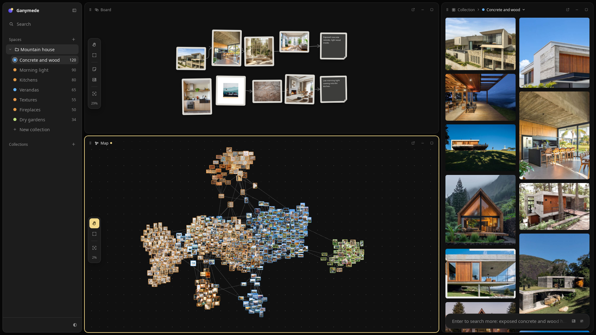
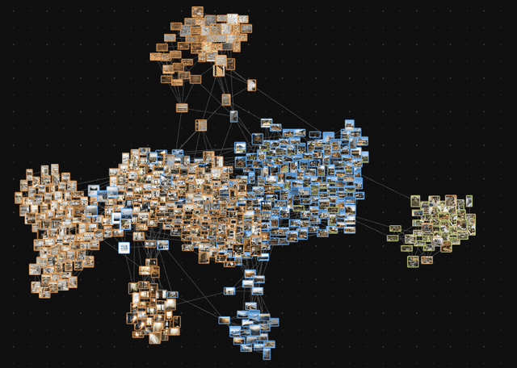
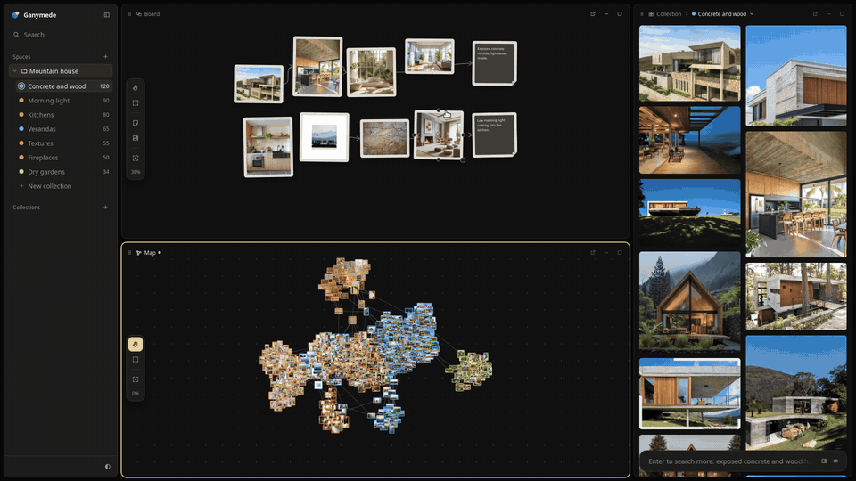

# Ganymede

**Visual references, found and arranged.** Describe an idea, keep the images that fit, and watch your references
arrange themselves on a living map.



[](https://github.com/jaoangeloni/ganymede/releases/latest)
[](LICENSE)

Ganymede is a desktop app for artists, illustrators, architects and designers who collect references before they
create. It brings search, curation and composition into one window, and your library stays on your computer.

## What you can do

**Search in plain words.** Type what you have in mind, like "wooden house in the mountains, morning light". You get a
page of images from the web. Approve the ones that fit and the next page moves toward them. Say what you don't want
("without people") and the results steer away from it. Filters narrow results by type, color, layout and size.

**Keep collections.** Each collection remembers the idea it came from, and its images can guide the next search, so a
mood board gets sharper with every round.

**Explore a living map.** Every image you save becomes a point on a map of your project, placed next to the images
that look like it. Hover an image to light up its look-alikes and preview it. Drag it, and its neighbors follow.



**Compose on a board.** Pin photos, write notes and draw arrows between them. Pieces tilt and land like paper, so the
board feels like a wall in your studio.

**Arrange your workspace.** Board, map and collection sit side by side. Drag them to split, swap or resize, minimize
what you don't need, or take one full screen.



**Spread across screens.** Pop any pane out into its own window and move it to a second monitor. Windows stay in sync,
and you can keep dragging references from one to another.

**Bring your own images.** Drop files in, paste from the clipboard or import from your computer. They join the map
next to the references they resemble.

**Private by default.** No account and no cloud. Images, collections and boards are saved on your machine, and
everything you saved still opens offline.

## Download

Get the Windows installer (`-setup.exe`) or the Linux `.deb`/`.AppImage` from the
[latest release](https://github.com/jaoangeloni/ganymede/releases/latest). Builds are unsigned: on Windows choose
"More info" → "Run anyway".

## Build from source

Install [Bun](https://bun.sh), [Rust](https://rustup.rs) and the
[Tauri prerequisites](https://v2.tauri.app/start/prerequisites/), then:

```bash
bun install
bun run model        # downloads the image model (~100 MB)
bun run tauri dev    # opens the app
```

## License

[MIT](LICENSE) © João Pedro Angeloni Alvarenga
